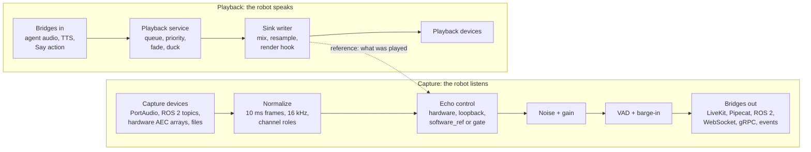

# RAL design

Robot Audio Layer (working name). Technical design, draft 0.1, October 2026.

This document is the source of truth for the architecture. Code that disagrees with it is either a bug or a reason to update this file in the same change.

## Contents

1. [What RAL is](#1-what-ral-is)
2. [Capabilities](#2-capabilities)
3. [Architecture](#3-architecture)
4. [Core abstractions](#4-core-abstractions)
5. [Audio path](#5-audio-path)
6. [Device discovery and probing](#6-device-discovery-and-probing)
7. [Integrations](#7-integrations)
8. [Recording, replay and benchmarks](#8-recording-replay-and-benchmarks)
9. [Tech stack, packaging and repo layout](#9-tech-stack-packaging-and-repo-layout)
10. [Milestones and acceptance criteria](#10-milestones-and-acceptance-criteria)
11. [Technical risks](#11-technical-risks)
12. [References](#12-references)

## 1. What RAL is

RAL is an open-source audio layer that sits between a robot's microphones and speakers and whatever speech stack the developer uses. It finds the audio devices (sound cards, USB mic arrays, or audio that a vendor HAL publishes over ROS 2), works out which channels are microphones and which carry the speaker reference, removes the robot's own voice from what it hears, plays audio with priorities and clean interruption, and hands everything to LiveKit, Pipecat, ROS 2 or a speech model through ready adapters and sockets. Every session can be recorded, so echo and latency become numbers, not impressions.

Agent frameworks handle the conversation. RAL handles the robot side and leaves every AI choice to the developer.

**For:** humanoid and social-robot developers, robot integrators, robot rental and event operators, research labs.

### Design principles

1. **Robot side only.** RAL plugs into existing agent stacks instead of replacing them.
2. **Reference by construction.** Everything RAL plays becomes the echo reference, so echo control never runs blind.
3. **Measure everything.** "Echo is gone" or "latency is fine" must be a number from a recording.
4. **Profiles, not code.** A new robot is a YAML profile plus, at most, a small backend plugin.
5. **Local-first.** Runs on the robot (x86_64 and ARM64, including Jetson-class boards) with no cloud dependency.
6. **Clean-room.** Written from scratch from public documentation; no code from any employer or client.

### Non-goals

- Not an agent, dialogue manager or LLM orchestration framework.
- Not a speech model. STT, TTS and speech-to-speech models plug in through ports.
- No language-specific features in the core. Languages are the models' job.
- Not a replacement for ROS 2 or a robot data platform.
- No beamforming research toolkit in v1. Arrays that beamform in hardware are supported as devices.

## 2. Capabilities

| Capability | What it does | Pain it removes |
|---|---|---|
| Doctor | Scans the host: sound cards, USB arrays, PipeWire or PulseAudio, ROS 2 audio topics and QoS, DDS settings, clock sync between boards, permissions. Prints what is usable and why the rest is not | "Why is there no microphone?", for example a compute board with no capture device while the mics live on another board |
| Probe | Plays a test sweep, records every channel, classifies mic, reference and dead channels, measures delay, echo gain, noise floor and clock drift, then writes a profile | Guessing channel layouts and delays by trial and error |
| Unified capture | One stream of timestamped 10 ms frames with channel roles, whatever the backend | Different formats, rates and message types on every robot |
| Echo control | Four modes (`hardware`, `loopback`, `software_ref`, `gate`) plus noise suppression and gain control | The robot hears itself and answers itself |
| VAD and barge-in | Speech start and end, plus an interruption policy that ignores the robot's own voice | The robot stops at its own echo, or cannot be interrupted at all |
| Playback service | Queue with priorities, fade-out on interrupt, ducking, volume, speaking state and timing | Overlapping sounds, clicks, no idea when audio actually left the speaker |
| Bridges and sockets | LiveKit, Pipecat, ROS 2, WebSocket and gRPC endpoints | Writing new glue for every stack |
| Model ports | Streaming interfaces for STT, TTS and speech-to-speech models, with reference adapters | Re-plumbing audio to try another model |
| Events | Speaking, listening, barge-in, word timings and direction of arrival, for gestures, LEDs and head turns | Body language out of sync with speech |
| Recorder and replay | Sessions saved as MCAP (mic, reference, processed, playback, events, transcripts), replayable through other settings | "It worked yesterday", and no way to compare two configurations |
| Metrics and health | Latency per stage, self-trigger rate, echo reduction, xruns, clipping, dead mics; exported to OpenTelemetry or Prometheus | No numbers to tell whether a change helped |
| Profiles | Versioned per-robot YAML files, shared by the community | Every team re-solving the same robot |

### Typical journeys

1. **Bring up a new robot.** `ral doctor` shows where the audio is; `ral probe` maps the channels and writes `my-robot.yaml`; `ral run --profile my-robot.yaml --bridge livekit` and the existing agent talks without hearing itself.
2. **Compare two settings.** Record 20 real conversations, replay them through a second echo or VAD configuration, and read `ral bench` side by side.
3. **Run many robots.** Robots at different venues report audio health and conversation-quality metrics; tuned profiles are rolled out deliberately and can be rolled back.

## 3. Architecture

One engine sits between the device backends and the developer's stack. Capture runs from the devices through echo control to the bridges; playback runs from the bridges through the playback service to the speakers; the reference path links the two. Side services (recorder, metrics and health, profiles and probe) observe both paths without sitting in them.



Bridges connect to code RAL does not own (agents, models, ROS 2 nodes, behaviours); devices are hardware access, through backends.

**Process model.** RAL runs either as a daemon (`ral run`, one per robot) that other processes reach through the bridges, or as a library inside a single Python process for prototypes. A small control API (REST and gRPC) reloads profiles, switches echo modes and exposes health without restarting audio.

## 4. Core abstractions

Everything rests on one data type (a timestamped 10 ms frame with channel roles) and a handful of interfaces. Every robot, model and stack is an implementation of one of them. Interfaces are `typing.Protocol`s, so plugins need no inheritance from RAL classes.

### Data types and interfaces

```python
from __future__ import annotations

from collections.abc import AsyncIterator, Callable
from dataclasses import dataclass, field
from enum import Enum
from typing import Protocol

import numpy as np


class ChannelRole(Enum):
    MIC = "mic"
    REFERENCE = "reference"    # loopback of what the speaker plays, on the same clock as the mics
    PROCESSED = "processed"    # already echo-cancelled by hardware
    UNUSED = "unused"


@dataclass(frozen=True)
class AudioFormat:
    sample_rate: int           # 16_000 inside the engine by default
    channels: int
    dtype: str                 # "int16" | "float32"
    frame_ms: int = 10         # WebRTC APM requires exactly 10 ms frames
    # Validated on construction: sample_rate * frame_ms must be a multiple of 1000,
    # so with 10 ms frames the rate must be divisible by 100 (44.1 and 48 kHz work, 22.05 does not).

    @property
    def frame_samples(self) -> int:
        return self.sample_rate * self.frame_ms // 1000


@dataclass(frozen=True)
class ChannelMap:
    roles: tuple[ChannelRole, ...]
    positions_m: tuple[tuple[float, float, float] | None, ...] | None = None  # optional mic geometry


@dataclass
class AudioFrame:
    # Validated on construction (shape, dtype, channel count). Before the Normalizer a frame
    # keeps the device's native rate and dtype; after it, float32 at the engine rate.
    data: np.ndarray           # shape (fmt.frame_samples, fmt.channels), dtype fmt.dtype
    fmt: AudioFormat
    channel_map: ChannelMap
    t_ns: int                  # monotonic estimate: first sample at the ADC (capture) or DAC (playback)
    seq: int                   # gap detection
    clock_id: str              # which device clock produced it


@dataclass(frozen=True)
class DeviceInfo:
    id: str                    # stable within a backend, e.g. "portaudio:wasapi:3", "ros2:/hal/audio/capture"
    name: str
    backend: str
    host_api: str | None
    max_input_channels: int
    max_output_channels: int
    default_sample_rate: float | None
    extra: dict[str, str] = field(default_factory=dict)


class AudioSource(Protocol):
    fmt: AudioFormat
    channel_map: ChannelMap
    async def start(self) -> None: ...
    async def stop(self) -> None: ...
    def frames(self) -> AsyncIterator[AudioFrame]: ...


class AudioSink(Protocol):
    fmt: AudioFormat
    async def start(self) -> None: ...
    async def stop(self) -> None: ...
    def write(self, frame: AudioFrame) -> None: ...      # enqueue; never blocks
    def output_latency_ns(self) -> int: ...
    def on_rendered(self, hook: Callable[[np.ndarray, int], None]) -> None: ...
    # hook(samples, t_dac_ns) runs on the output thread for every block handed to the
    # device, silence included. The ReferenceProvider subscribes here.


class DeviceBackend(Protocol):
    name: str                  # "portaudio", "ros2_topic", "file", ...
    def discover(self) -> list[DeviceInfo]: ...
    def open_source(self, device: DeviceInfo, fmt: AudioFormat, channel_map: ChannelMap) -> AudioSource: ...
    def open_sink(self, device: DeviceInfo, fmt: AudioFormat) -> AudioSink: ...


class ReferenceProvider(Protocol):
    """What was played, resampled onto the mic clock."""
    def push(self, samples: np.ndarray, t_dac_ns: int) -> None: ...
    def frames_until(self, t_dac_ns: int) -> list[AudioFrame]: ...  # 10 ms frames, oldest first


@dataclass(frozen=True)
class Event:
    t_ns: int
    session_id: str


@dataclass(frozen=True)
class SpeechStarted(Event):
    pass


@dataclass(frozen=True)
class BargeIn(Event):
    interrupted_tag: str | None


@dataclass
class FrameContext:
    session_id: str
    reference: list[AudioFrame]    # reference frames fed to echo control for this mic frame
    robot_speaking: bool
    events: list[Event]            # stages append events; the engine publishes them
    info: dict[str, float]         # per-frame measurements shared by stages (mic_db, out_db, ref_db, echo_db)


class Processor(Protocol):
    """One stage of the capture graph."""
    def process(self, frame: AudioFrame, ctx: FrameContext) -> AudioFrame: ...
    def reset(self) -> None: ...


@dataclass(frozen=True)
class PlaybackHandle:
    id: int
    tag: str


class PlaybackService(Protocol):
    def play(self, audio: AsyncIterator[AudioFrame], *, priority: int = 50,
             interruptible: bool = True, tag: str = "") -> PlaybackHandle: ...
    async def stop(self, handle: PlaybackHandle, fade_ms: int = 40) -> None: ...
    def duck(self, gain_db: float, duration_ms: int) -> None: ...


@dataclass(frozen=True)
class WordTiming:
    word: str
    t_start_ns: int
    t_end_ns: int


@dataclass(frozen=True)
class Transcript:
    text: str
    is_final: bool
    t_start_ns: int
    t_end_ns: int
    words: tuple[WordTiming, ...] = ()


@dataclass(frozen=True)
class SpeechChunk:
    frame: AudioFrame
    words: tuple[WordTiming, ...] = ()   # filled when the TTS model reports word timings


class SpeechToText(Protocol):
    def transcribe(self, frames: AsyncIterator[AudioFrame]) -> AsyncIterator[Transcript]: ...


class TextToSpeech(Protocol):
    def synthesize(self, text: AsyncIterator[str]) -> AsyncIterator[SpeechChunk]: ...


class RealtimeModel(Protocol):     # speech-to-speech models
    def converse(self, frames: AsyncIterator[AudioFrame]) -> AsyncIterator[SpeechChunk | Event]: ...


class Bridge(Protocol):
    async def attach(self, engine: Engine) -> None: ...
    async def detach(self) -> None: ...
```

### Main classes

| Class | Responsibility | First implementations |
|---|---|---|
| `Engine` | Owns clocks, ring buffers, the processing graph and services; start, stop, reload profile | One per robot process |
| `DeviceBackend` | Opens sources and sinks of one kind | `FileBackend`, `PortAudioBackend`, `Ros2TopicBackend`; later `PipeWireBackend`, `NetworkBackend` |
| `RingBuffer`, `Framer` | Single-producer, single-consumer buffers per stream; turn device blocks of any size into exact 10 ms frames with timestamps | numpy-backed |
| `Doctor` | Read-only host scan and report | `HostScanner`, `PortAudioScanner`, `Ros2GraphScanner`, `DdsCheck`, `ClockSyncCheck` |
| `Prober` | Active tests that write a profile | `SweepProbe`, `NoiseFloorProbe`, `DriftProbe`, `ProfileWriter` |
| `ReferenceBuffer` | Implements `ReferenceProvider`: stores rendered audio with DAC timestamps (framed from the sample count like capture), downmixes it to mono, resamples it onto the mic rate and clock | One per engine |
| Clock sync | Delay and drift between playback and capture | `DelayEstimator` (GCC-PHAT), `DriftEstimator`, adaptive resampling |
| Processors | Stages of the capture graph | `Normalizer`, `EchoController` (`WebRtcAec`, `HardwareAecPassthrough`, `DuplexGate`), `NoiseSuppressor`, `Agc`, `Vad` (Silero ONNX, energy fallback), `BargeInDetector` |
| `PlaybackService` | Queue, priorities, fades, ducking | `PlaybackQueue`, `Mixer`, `SinkWriter` |
| `EventBus` | Typed events fanned out to bridges and the recorder | asyncio pub/sub |
| `Recorder`, `Replayer` | Session capture and offline or hardware-in-the-loop replay | `McapRecorder`, `Replayer` |
| `Metrics` | Numbers about every turn and device | `LatencyTracker`, `EchoMetrics`, `HealthMonitor` |
| `ProfileManager` | Load, validate, migrate and share profiles | pydantic schema plus a profile registry |
| Bridges | Connect the engine to outside stacks | `LiveKitBridge`, `PipecatTransport`, `Ros2Bridge`, `WebSocketBridge`, `GrpcBridge` |
| Model ports | Thin adapters to speech models | one local and one cloud adapter per port type |

### Events

`SpeechStarted`, `SpeechEnded`, `BargeIn`, `PlaybackStarted` (first sample estimated at the DAC), `PlaybackEnded`, `WordSpoken` (a TTS word timing re-stamped to DAC time; named so it does not clash with the port's `WordTiming` record), `DirectionOfArrival`, `EchoLeak` (robot speech detected in the cleaned signal), `DeviceLost`, `Xrun`, `Clipping`, `ProfileReloaded`, `RecordingStarted`, `RecordingStopped`. Every event is a frozen dataclass deriving from `Event`, carries a monotonic timestamp (for audio events, when the sound was at the ADC or DAC, not when the event was emitted) and the session id, and serialises to JSON as `{"type": "<ClassName>", ...}` for sockets and recordings. Subclasses from plugins deserialise without registration. The `EventBus` (asyncio) never blocks a publisher: each subscriber has a bounded queue and a slow subscriber loses its oldest events; the DSP thread publishes through `publish_threadsafe`.

### Plugin system

Python entry points: `ral.backends`, `ral.processors`, `ral.bridges`, `ral.models`, `ral.decoders` (vendor ROS 2 audio messages). Vendor-specific code lives in separate packages, so message definitions under a vendor licence never enter the Apache-2.0 core.

### Extension points

Keep these interfaces stable and documented, because separately packaged modules build on them: the plugin entry points, the metrics exporter interface, the control API, and the profile schema (versioned, with migrations). The core never imports from such modules.

## 5. Audio path

Echo control picks one of four modes from what the hardware offers. The engine's job is to make sure the reference reaches the echo canceller before its echo does. Most robot echo failures come from a missing or misaligned reference, not from a weak echo canceller.

### Capture chain

1. **Backend** delivers raw blocks in the device's native format (for example 6 channels of 16-bit PCM from a HAL topic, or 2 channels from a USB card).
2. **Framer** cuts blocks into exact 10 ms frames in the device's native rate and dtype and stamps each with `t_ns`.
3. **Normalizer** converts to float32, resamples to the engine rate (16 kHz default, 48 kHz optional) and applies the channel map: `unused` channels are dropped, the others keep their order and roles. Reference channels are resampled with the same settings as the mics. The resampler is time-aligned (output sample `k` estimates the input at `k * M / L`), so each output frame inherits the `t_ns` and `seq` of the input frame covering the same 10 ms; its lookahead (about 1.5 ms) delays availability, not timestamps. A `seq` gap flushes the resampler and starts a new run.
4. **Echo controller** removes the robot's own audio using the mode below. In v0.1 it runs on one selected mic channel (`echo.mic`, an index or `mean`); multi-channel AEC comes later. Raw channels still go to the recorder.
5. **Noise suppression and gain control** clean the residual.
6. **VAD and barge-in detector** emit speech events and decide whether an interruption is real.
7. **Clean stream** (mono, or the processed channel of a hardware array) goes to bridges and the recorder.

### Echo-control modes

| Mode | Use when | How it works | Expected quality |
|---|---|---|---|
| `hardware` | The mic array has on-board echo cancellation | RAL sends all playback through that device so it sees the reference, takes the processed channel and turns software AEC off. Example: the XMOS XVF3800 processes 4 mics against one mono reference on the left input channel, with a 192 ms tail | Best, if the array is placed well |

| `loopback` | The capture stream already contains reference channels on the same clock (common on robot HALs that return mic and speaker loopback together) | WebRTC AEC3 with the reference channels; delay is small and stable | Good |
| `software_ref` | RAL is the only thing that plays audio, but no loopback exists | The reference is exactly what RAL rendered, with its estimated DAC time; delay comes from the probe and is tracked online; drift is compensated when capture and playback use different clocks | Good when delay is stable; weaker with drift or distorting speakers |
| `gate` | Audio is played by something RAL cannot see | Mic is attenuated (by 45 dB; 30 dB left echo that an energy VAD still heard in simulated rooms) while speech plays plus a tail; the echo level is a peak-hold that does not learn frames 10 dB above it; barge-in only above the learned echo level, by keyword, or by a button | Usable fallback, not full duplex. `ral doctor` says why you ended up here |
| `off` | Benchmarks only | The selected mic passes through unchanged | The baseline that `ral bench` and the CI echo tests compare against |

The default AEC engine is WebRTC APM through the LiveKit Python SDK. Its `AudioProcessingModule` offers echo cancellation, noise suppression, high-pass filtering and gain control, with `process_stream` for the mic, `process_reverse_stream` for the far end, `set_stream_delay_ms`, and exactly 10 ms frames. LiveKit's `rtc.AudioFrame` carries int16 samples, so this stage converts float32 frames to int16 and back. Other engines (SpeexDSP, vendor DSPs) plug in as processors.

In `hardware` mode (`HardwareAecPassthrough`) RAL takes the `processed` channel, keeps software AEC off, and still measures levels for barge-in: the raw mic if the firmware exposes one, and the reference from a `reference` channel or from what RAL rendered, so the double-talk detector learns the residual echo the device leaves. The engine refuses `hardware` without a `processed` channel and warns when playback is not on the capture device.

### Reference alignment

A reference that reaches the echo canceller after its echo cannot be cancelled. Timing errors must therefore always fall on the early side.

- **`loopback`:** reference and mics share a frame and a clock. For each frame the engine feeds the reference channels (their mean) to the reverse stream first, then processes the mic channel, with a stream delay near zero. An optional mic delay of a few milliseconds (`echo.mic_delay_ms`, default 0) adds headroom; it is passed as the stream delay and added to the clean stream's lag. Synthetic tests reach the same ERLE as `software_ref` (about 44 dB).
- **`software_ref`:** the sink's render hook pushes every block handed to the device, silence included, into the `ReferenceBuffer` together with its estimated DAC time. Before processing the mic frame captured at `t`, the engine feeds the reverse stream every reference frame whose estimated DAC time is earlier than `t + lead`, then processes the mic frame and passes `lead` as the stream delay. The reference therefore precedes its echo by roughly `lead` even when estimates are a few milliseconds off, and AEC3's internal delay estimator finds the exact offset. `lead` is tunable; the default is 20 ms (range 10 to 30 ms), settled with `ral bench`. On synthetic echo (`spikes/apm_feasibility.py`) AEC3 reached the same ERLE whether the hint was 0, `lead` or `lead` plus the true delay, while a reference 30 ms late dropped ERLE from about 36 to 7 dB. Frames already rendered but not yet played are available, so a lead up to the output buffering is always possible.
- **Continuous reverse stream:** the `software_ref` controller keeps the reverse stream continuous in DAC time up to `t + lead`: holes (nothing rendered, as with an idle offline sink) are filled with silent frames, and a reference frame for time already covered is late anyway and is dropped and counted. AEC3 behaves differently without a steady render stream (even its output lag changes), so this matters.
- **APM output lag:** the APM's output trails its input by 8 ms with echo cancellation and 6 ms with noise suppression, and the two add up (14 ms); the high-pass filter and gain control add nothing (`spikes/apm_lag.py`, re-checked by the tests on every livekit version). The echo controller therefore stamps clean frames with the capture time of the samples they carry (`t_ns` minus the lag), and the lag appears in the latency breakdown.
- **ROS 2 sinks:** the DAC time is unknown, so it is estimated as publish time plus `playback.latency_ms` measured by the probe.

### Clocks, delay and drift

- Every capture frame carries `t_ns` (ADC time estimate); every rendered block carries its estimated DAC time. The echo delay is the gap between a sample leaving the DAC and its echo reaching the ADC.
- **The RAL clock.** Every timestamp comes from `ral.core.clock.now_ns()`, integer nanoseconds. It is `time.monotonic_ns()` on Linux and macOS. On Windows before CPython 3.13, `time.monotonic()` advances in 15.6 ms steps (coarser than a frame; see `spikes/clock_resolution.py`), so RAL uses `time.perf_counter_ns()` (QueryPerformanceCounter) there.
- The Framer stamps frames from the sample count (`t_anchor + samples / rate`), not from each callback, so callback jitter never reaches `t_ns`. Callback timestamps are observations: the timeline re-anchors only when it disagrees with them by more than a threshold (2 ms) for several observations in a row (3), or at the first disagreement after a gap. Frames sit on a fixed grid of the absolute sample index, so `seq` jumps by exactly the frames lost to an overrun (capture drops the oldest samples) or to a forward time jump of at least one frame; a hole in `seq` always means missing audio.
- PortAudio reports `inputBufferAdcTime` and `outputBufferDacTime` in its callbacks; the backend maps them to the RAL clock. PortAudio's clock is QueryPerformanceCounter on Windows (`spikes/portaudio_time.py`) but is not guaranteed to match elsewhere, so every callback measures the offset `now_ns() - currentTime` and the backend keeps its lower envelope. Some host APIs report zeros, and DirectSound reports a DAC time equal to `currentTime`; in both cases the fallback is callback time minus (or plus) the stream's reported latency. Streams open at the device's native rate with `blocksize=0` (the host picks the block size).
- The probe measures the initial delay; a GCC-PHAT estimator tracks it online and updates the alignment when it moves.
- When capture and playback are different devices or boards, their sample clocks disagree by some parts per million. `DriftEstimator` measures it from sample counts against monotonic time, and the `ReferenceBuffer` resamples the reference onto the mic clock with a slowly varying ratio. Implementation (M3): each stream's Framer reports its timestamp observations to a `DriftEstimator` (a least-squares line of sample index against RAL time over 120 s, refitted once a second), and Framers follow the measured rate so `t_ns` no longer steps. Drift in ppm is the ratio of the two relative rates; `DriftCorrector` (windowed sinc with a 1024-phase kernel table, -92 dB) resamples the reference by `1 / (1 + drift)`, starting from the probe's `echo.drift_ppm`. With the speaker 500 ppm fast, ERLE after a minute stays at 43 dB instead of falling to 31.5 dB (`spikes/drift_erle.py`).
- When audio crosses boards (ROS 2 topics between two SoCs), timestamps are only as good as the boards' clock sync, so `ral doctor` checks chrony or PTP offsets.

### Playback

- Priority queue: alerts above speech, speech above earcons and music; each item is interruptible or not.
- Interrupts fade out over 20 to 50 ms to avoid clicks; ducking lowers background audio under speech.
- `PlaybackStarted` fires when the first sample is estimated at the DAC, not when the request arrives, so gestures and lip sync line up with real sound. Word timings from TTS are re-stamped to the same clock.
- Underruns render silence, and the silence also goes to the reference, so the echo canceller's timeline stays continuous.
- **v0.1 model** (`PlaybackQueue`): an item starts once 30 ms are queued (a small jitter buffer) or its producer has finished; one item plays at a time; a higher-priority item preempts an interruptible one (fade out, dropped, not resumed); suggested priorities are alerts 90, speech 50, earcons 30, music 10. Mixing concurrent items is M2. Each item's async iterator is pumped into a short queue (500 ms), so a slow producer never stalls output; a missing frame becomes silence at the sink. Fades are raised-cosine; `duck` ramps the output gain over 30 ms. Barge-in calls `interrupt()`, which fades the playing item and drops queued interruptible items.
- **`SinkWriter`** resamples the mono engine frames to the sink's rate, copies them to every sink channel and converts the dtype. In realtime it keeps at most `ahead_ms` (40 ms; at least four asyncio timer ticks, about 62 ms on Windows before Python 3.13) queued past the device latency, which bounds how late an interrupt takes effect. It keeps a DAC-time cursor: `now + output_latency` after the sink ran dry, plus 10 ms per frame while audio flows. `PlaybackStarted`, `PlaybackEnded` and `speaking_at(t)` come from that cursor, and the events are published when their DAC time arrives.

### Barge-in policy

A barge-in fires only when all of these hold: VAD detects speech in the echo-cancelled residual; the double-talk detector sees residual energy clearly above the predicted echo; speech lasts at least a minimum time (default 250 ms, configurable); and the residual does not correlate with the reference (the echo-leak guard). On barge-in, the current playback fades out and bridges tell the agent to cancel its turn. Policies: `off`, `energy`, `vad`, `vad+dtd` (default).

Implementation (`ral.dsp.bargein`): the 250 ms count only frames where all conditions hold, and a candidate expires after 200 ms without one, because during double talk AEC3 lets a quieter user through in bursts. The double-talk detector learns `leak_db`, the residual level relative to the reference during robot-only speech, and predicts the echo of a frame as `leak_db` plus the loudest reference level of the last 300 ms (the echo of a word lingers as reverberation). Until it has learned 300 ms of robot-only speech, nothing counts as double talk, because an unconverged canceller's residual looks like a talker. In `gate` mode the raw mic must exceed the gate's learned echo level instead. The echo-leak guard correlates the per-frame dB envelopes of residual and reference over the candidate speech (up to 600 ms, lags up to 200 ms); above 0.7 the barge-in is suppressed and `EchoLeak` is emitted. After a barge-in the detector stays quiet until the robot stops speaking. On the synthetic CI scene (five utterances in 20 s), the energy VAD self-triggers 31 times per minute of playback without AEC and 4.4 with `software_ref` (all during the first utterance, while AEC3 converges); a user talking over the robot at 12.0 s produces one barge-in at 12.0 s.

All VAD engines share one state machine: speech starts when the probability stays at or above the threshold for `min_speech_ms` (with 0.15 of hysteresis), and ends after `hangover_ms` of non-speech. `SpeechStarted.t_ns` is the first speech sample and `SpeechEnded.t_ns` the end of the last speech window, so the hangover shows up in the latency breakdown instead of in the timestamps. The energy VAD (no dependencies) compares the frame level with a noise floor that falls fast and rises at 2 dB/s.

Noise suppression, the high-pass filter and gain control run in the same WebRTC APM instance as AEC in `software_ref` (one module, lags add up); in `gate` and `off` modes they run as a separate APM stage after the gate.

Silero VAD (v6.2.3, pinned) works on 512-sample windows at 16 kHz (32 ms), each preceded by the previous window's last 64 samples (without that context the model returns almost zero on real speech; `spikes/silero_io.py`), so the VAD stage buffers 10 ms frames and stamps events with the window's capture time; other engine rates are resampled to 16 kHz. Run the ONNX model directly with onnxruntime on one thread; the `silero-vad` pip package pulls in PyTorch, which is too heavy for robots. The model is not bundled: `ral models fetch silero_vad` downloads it from the official repository, checks its SHA-256 and caches it (`$RAL_MODELS_DIR` or the user cache directory). onnxruntime 1.23 is the last release with CPython 3.10 wheels, so 3.10 installs stay on it.

### Latency targets

Design targets, to be verified with `ral bench`: capture buffering 10 to 20 ms, under 10 ms of processing per frame, end-of-speech hangover configurable from 200 to 500 ms (it dominates the total). RAL reports every turn as a breakdown, so the slow stage is always visible.

## 6. Device discovery and probing

`ral doctor` only looks; `ral probe` makes sound and measures. Both end in a profile file that the engine runs from.

### What `ral doctor` checks

| Area | Checks | Typical finding |
|---|---|---|
| Local audio | PortAudio host APIs and devices, ALSA cards, PipeWire or PulseAudio servers and whether they hold a device exclusively, supported rates and channel counts, user permissions, missing system PortAudio library | "No capture device on this board; look for audio on ROS 2 topics" |
| USB arrays | Vendor and product IDs matched against the community device database (on-board AEC, which input carries the reference, output channels) | "Hardware AEC available: use mode `hardware` and play through this device" |
| ROS 2 | RMW implementation, domain ID, discovery-server settings, visible audio topics and types, publisher QoS against what RAL requests, message rate and chunk size, decoder plugin present for vendor types | "Topic found but QoS incompatible: publisher is best-effort" |
| Time | Clock offset between boards when audio crosses machines (chrony or PTP status) | "Boards differ by 40 ms: fix time sync before tuning AEC" (example) |
| Network | Reachability and round-trip time to LiveKit, WebSocket and gRPC endpoints | "LiveKit server unreachable from this host" |
| Result | Green, amber or red per area and a suggested echo mode | `suggested_mode: loopback` |

Every check returns structured findings (`area`, `level`, `message`, `hint`), printed as a table or as JSON with `--json`. Levels are `ok`, `info`, `warn` and `error`; an area's colour is its worst level (`info` is context and never changes it), and `ral doctor` exits with status 1 when any finding is an error. The ROS 2 section runs only when `rclpy` imports; otherwise the report lists it as skipped. A check that crashes becomes an error finding instead of stopping the doctor.

On Windows, PortAudio lists the same physical device under several host APIs (MME, DirectSound, WASAPI, WDM-KS). Doctor groups devices by host API and prefers WASAPI there; on Linux it prefers ALSA or the PipeWire and PulseAudio servers.

### What `ral probe` does

1. **Noise floor.** Records 2 s of silence on every channel; flags dead or clipped channels.
2. **Sweep test.** Plays a logarithmic sweep through each candidate output at a capped volume and records all inputs.
3. **Channel roles.** Deconvolves each channel against the sweep. Near-perfect correlation with almost no delay and a flat response means a reference channel; an acoustic response with reverberation means a microphone; nothing means unused.
4. **Delay and echo gain.** Measures playback-to-capture delay and echo level per microphone; this seeds the alignment.
5. **Drift.** Repeats short sweeps over 60 s and estimates the clock drift between output and input in parts per million.
6. **Output.** Writes a profile YAML and an HTML report with waveforms, spectrograms and the measured numbers.

The probe warns before playing, caps volume, and has a `--quiet` mode that skips sound when people are nearby.

Implementation (`ral.probe`): exponential sweeps (2 s, 100 Hz to 0.45 x rate, -20 dBFS, capped at -6) deconvolved with Farina's inverse filter. Sweeps are played through the engine's playback service, so they also reach the reference buffer, and `PlaybackStarted` gives their DAC time: impulse-response index 0 is the DAC time, so the peak is the playback-to-capture delay. Classification: dead below -110 dBFS in silence; `reference` when the response is strong, under 5 ms and over 20 dB more direct than reverberant; `processed` when the channel is alive but more than 20 dB below the loudest mic (the device cancelled the sweep); `mic` otherwise if it responds; `unused` if not. Drift is the slope of the first mic's delay over repeated sweeps (`--drift-s`). Echo-mode suggestion: `hardware` if a processed channel exists or the device database says the device cancels echo and playback is on it, else `loopback` with a reference channel, else `software_ref` with mics, else `gate`. Output: a profile whose header records the measurements, and an HTML report with inline SVG impulse responses. TODO(M3): spectrograms in the report. `ral probe --simulate` runs the same analysis on a simulated robot.

### Example profile

```yaml
ral: 1                              # profile schema version
robot:
  model: example-humanoid
  firmware: ">=1.0"
  validated_by: community           # community | maintainer | certified
capture:
  backend: ros2_topic
  topic: /hal/audio/capture
  decoder: vendor_audio_frame       # plugin for the vendor message type
  format: {rate: 16000, channels: 6, dtype: int16}
  channels: [mic, mic, mic, mic, reference, reference]
playback:
  backend: ros2_topic
  topic: /hal/audio/playback
  format: {rate: 16000, channels: 1, dtype: int16}
  latency_ms: 60                    # publish-to-DAC estimate from the probe (example value)
echo:
  mode: loopback                    # hardware | loopback | software_ref | gate
  engine: webrtc_aec3
  mic: 0                            # mic channel used for AEC in v0.1, or "mean"
  lead_ms: 20                       # used by software_ref
  drift_ppm: 0
pipeline: [aec, noise_suppression, agc, vad]
vad: {engine: silero, threshold: 0.5, min_speech_ms: 250}
barge_in: {policy: vad+dtd}
bridges:
  livekit: {url: "${LIVEKIT_URL}", room: lab, publish: clean_mic, play: agent_audio}
  websocket: {port: 8765}
recording: {enabled: false}
```

Profiles are found by `ral.profiles.registry`: a file path, then the folders in `$RAL_PROFILES_PATH`, then the user's profile folder, then the built-in set (`laptop`, `respeaker-usb-v2`); a user profile with a built-in name overrides it, which is how a tuned profile is rolled out and, by deleting it, rolled back. Older schema versions pass through `ral.profiles.migrations` (pure dict-to-dict steps, one per version) before validation; a profile newer than RAL is refused with an upgrade hint. `ral profile list | show | validate | migrate` manage them. Profiles are validated with pydantic and unknown keys are errors, so a typo cannot silently fall back to a default. `${VAR}` and `${VAR:-default}` in strings come from the environment, so secrets stay in `.env`. A bare `off` in YAML 1.1 is the boolean false; the schema accepts it as the string `off` where a mode or policy is expected. Built-in profiles ship in `ral/profiles/builtin/` (`ral run --profile laptop`).

### Device database

A small community-maintained YAML catalogue keyed by USB vendor and product ID (and later by ROS 2 message type) with what each device can do. It turns hard-won knowledge ("this array expects the reference on the left channel") into data that `ral doctor` applies automatically. It ships inside the package (`ral/devicedb/devices.yaml`) so an installed `ral` has it. Entries match by USB id (when the platform reports it), by a substring of the device name and optionally by the input channel count (one board, several firmwares). Every fact cites a public source; facts no public source states (for example the XVF3800's USB output channel layout) are left out for `ral probe` to measure, and `validated_by: docs` marks entries not yet tested on hardware. `ral doctor` names known devices with their echo mode and channel layout.

## 7. Integrations

RAL integrates by standing in for the microphone and speaker that each stack already expects, so existing agent code does not change. Every integration routes playback back through RAL, which keeps the echo reference intact.

| System | How RAL connects | What the developer writes |
|---|---|---|
| LiveKit Agents | `LiveKitBridge` joins the room as the robot participant (URL plus a token, or API key and secret to mint one), publishes the clean mic track, subscribes to the agent's audio and plays it through the playback service; events go out as data messages | Nothing in the agent; one `bridges.livekit` block in the profile |
| Pipecat | `RalTransport` (separate package `ral-pipecat` under `integrations/pipecat`, Python 3.11+) implements Pipecat's `BaseTransport` and talks to a running RAL over the WebSocket bridge; an in-process variant can follow | Swap the local audio transport for the RAL transport |
| ROS 2 | `ral_ros` node publishes clean audio as `audio_common_msgs/AudioDataStamped` plus `AudioInfo` on a transient-local topic (the data message carries raw bytes without format), plus an event topic; v0.2 takes audio to speak on a `play` topic and control (`interrupt`, `stop`, `duck`, `end`) as JSON on a `control` topic, and the `Say` and `PlayAudio` actions and `stop` and `duck` services follow with an interface package (M3) | `ros2 launch ral_ros robot.launch.py profile:=my-robot.yaml` |
| Speech-to-speech models | `RealtimeModel` port streams clean audio to the provider and plays its answer through the playback service | API key and instructions in the profile |
| Standalone STT and TTS | `SpeechToText` and `TextToSpeech` ports with one local and one cloud reference adapter each | Choose models in the profile, or write a small adapter |
| Any language (C++, Rust, C#, JS) | WebSocket with binary PCM frames and JSON control; gRPC streaming for typed clients | A small client |

**Pipecat transport** (`integrations/pipecat`, pipecat-ai 1.13): a separate package because pipecat-ai needs Python 3.11+ while RAL supports 3.10 (ROS 2 Humble), and because it pulls `soxr` (LGPL-2.1), which stays out of RAL's dependency tree. Input: RAL's clean frames as `InputAudioRawFrame`, Pipecat's own VAD and turn logic unchanged, and a RAL `BargeIn` broadcasts an interruption. Output: each bot utterance is one RAL item (`play` with its sample rate; RAL resamples), written up to 100 ms ahead of real time like a sound card's buffer; it ends when Pipecat announces `BotStoppedSpeaking` (after a TTS's `TTSStoppedFrame` flushes the last chunk), so the resampler's last frame is not held until an idle timeout; Pipecat's interruption sends `interrupt`.

**LiveKit bridge** (`ral.bridges.livekit`, `livekit` extra with `livekit` and `livekit-api`): joins as `identity` (default `robot`) with a token or with a key and secret that mint one; publishes the clean stream as its microphone track and receives remote audio with `AudioStream(frame_size_ms=10)` at the engine rate (no resampling either way; `spikes/livekit_room.py` measured about 64 ms through a local room). A remote track is continuous, so it is cut into utterances by level (start above -50 dBFS, end after 300 ms below) and each utterance becomes one playback item; otherwise the robot would count as speaking all the time. After a barge-in the rest of the cancelled turn is dropped until the agent falls silent. Events go out as data on topic `ral.events`; `ral.control` accepts `interrupt`, `duck` and `stop`.

**WebSocket protocol v1** (`ral.bridges.websocket`, `websockets` in the `server` extra; a lighter choice than FastAPI for one socket, FastAPI can come with the REST control API). Server to client: a `hello` JSON message with the session id and formats, then binary clean frames (10 ms, `pcm-s16`, mono, engine rate; `?audio=0` for events only) and every event as JSON text. Client to server: binary PCM (at the playback rate, or at the `rate` the last `play` named; RAL resamples) joins the connection's current utterance, played through the playback service as one interruptible item; JSON `play` (tag, priority, interruptible), `end`, `stop`, `interrupt`, `duck` and `ping`. The server listens on 127.0.0.1 unless the profile names another address, because a listening socket exposes the robot's microphone. Slow clients lose their oldest messages instead of delaying others.

| Robot behaviour | `EventBus` to ROS 2 topics, webhooks or a gRPC stream: speaking, listening, barge-in, word timings, direction of arrival | Map events to gestures, LEDs, head turns |
| Hardware AEC arrays | Device database entry plus `hardware` echo mode | Nothing |
| Vendor HALs | Backend or decoder plugin per vendor message type, each profile marked community, maintainer-tested or certified | Contribute a plugin and a profile |
| Observability | OpenTelemetry metrics and traces (one span per turn stage), Prometheus endpoint, MCAP recordings readable in Foxglove | Point a collector at it |

### Notes on the ecosystem

- ROS 2 already has standard audio messages: `audio_common_msgs` provides `AudioData`, `AudioDataStamped` and `AudioInfo` for Humble, Jazzy, Kilted, Lyrical and Rolling. RAL uses them by default and treats vendor types as plugins.
- MCAP is the default rosbag2 storage format since ROS 2 Iron and has Python, C++, Rust and other libraries, so RAL recordings open in tools robotics teams already use.
- Pipecat's `TransportParams` carries audio input and output settings and generic input and output filters, so RAL can also ship as an input filter for teams that keep their own transport.
- `rclpy` is not on PyPI; it comes from a sourced ROS 2 installation. ROS 2 code imports it lazily, and everything else works without it.
- Robots whose makers expose no audio interface to third parties are out of scope until they do.

### ROS 2 implementation notes (M2)

- `ral.ros2.Ros2Runtime` owns its own rclpy `Context`, node and `SingleThreadedExecutor` thread; subscription callbacks run there and only decode and copy into a Framer. API checked against the rclpy `humble` sources (docs.ros.org blocks automated readers).
- `ros2_topic` capture (`Ros2TopicSource`) maps message stamps (ROS time) onto the RAL clock through the lower envelope of `now_ns() - ros_now`; unstamped messages are timed at arrival minus their duration. The profile must give `capture.format`, because audio messages carry none. Decoders: `audio_common` (stamped) and `audio_common_unstamped` built in; vendor types through the `ral.decoders` entry point.
- `ros2_topic` playback (`Ros2TopicSink`) publishes one 10 ms `AudioDataStamped` per tick on absolute deadlines, silence included, plus `AudioInfo` once on `<topic>_info` (transient local); the DAC time is publish time plus `playback.latency_ms`.
- `uint8[]` fields are `array.array('B')` in rclpy (rosidl_generator_py); RAL assigns one directly, which skips per-element checks.
- `Ros2Bridge` (namespace `/ral`): `clean` + `clean_info`, `events` (`std_msgs/String` JSON), `play` (each burst one playback item, ending after 300 ms without audio) and `control`.

### Robot targets, in order

1. **Laptop plus USB speaker and mic** (`software_ref`): every developer can try RAL in 10 minutes.
2. **USB array with hardware AEC** (XVF3800 class): the cheapest way to show `hardware` mode.
3. **A low-cost open robot** with documented audio access.
4. **Humanoids through partners**: profiles validated by integrators or labs that own them.

## 8. Recording, replay and benchmarks

Recording turns RAL from glue code into a tool: the same session can be replayed through any configuration and scored. It is off by default because robots record people.

### What a session contains

One MCAP file per session with channels for raw mic, reference, processed audio, playback, VAD and barge-in events, transcripts and model timings when bridges report them, the active profile, and host information. Audio is stored as Foxglove's `foxglove.RawAudio` (JSON schema, `pcm-s16`, base64 data; one message per 10 ms frame), so recordings play back in Foxglove; channel roles and the clock id go in the MCAP channel metadata. `spikes/mcap_rawaudio.py` measured a bit-exact round trip and about 2 MB per minute per mono 16 kHz channel with zstd chunks. v0.1 channels: `/ral/mic` (normalized capture, all channels, before echo control), `/ral/reference` (what echo control was fed), `/ral/clean` and `/ral/events`; metadata records hold the session, host, profile and the RAL-clock-to-wall-time mapping at the start. Log times are RAL clock values. A writer thread does the file I/O. Transcripts and events are JSON. TODO(M2): transcripts and model timings from bridges, and a protobuf audio channel if size matters.

### Replay modes

- **Offline:** feed recorded mic and reference through another echo, noise or VAD configuration and compare outputs; no hardware needed. `ral.record.replay` rebuilds the inputs (mic frames with roles, reference frames with DAC times, playback intervals from the events) and runs them through the same `CaptureGraph` and `build_stages` the engine uses. `ral bench SESSION --echo A --echo B` (or `--config profile.yaml`, `--vad`, `--json`) prints them side by side: ERLE while the robot spoke (a lower bound, double talk included; for `gate` it is the attenuation), speech starts during robot speech per minute (an upper bound of the self-trigger rate without labels), barge-ins, echo leaks and processing time per frame. Turn latency comes from the recording, because the agent cannot be replayed. `ral bench --demo` does the same on a synthetic session.
- **Hardware in the loop:** play recorded human speech through a speaker at set distances and noise levels toward a real robot, and score the robot's capture.

### Metrics

| Metric | Definition | Why it matters |
|---|---|---|
| Turn latency | End of user speech to first robot audio at the DAC, split into VAD hangover, STT final, model first token, TTS first audio and playback start. v0.1 (`LatencyTracker`, a `TurnLatency` event per turn, summary at the end of `ral run`) measures hangover (until RAL decided the user finished), agent (until the reply's first audio reached RAL) and playback (until the DAC); bridges that report model timings will split the agent stage | Shows which stage to fix |
| Self-trigger rate | VAD speech starts during the robot's own playback that no real user speech explains, per minute of playback | The "robot answers itself" bug as one number |
| ERLE | Echo return loss enhancement in dB during robot-only speech | Standard AEC quality measure |
| Barge-in precision and recall | Against labelled sessions | Interrupts when it should, ignores itself |
| WER (optional) | Word error rate against reference transcripts | Language-neutral; the language is the developer's choice |
| Health | Xruns per hour, clipping share, dead channels, noise-floor drift | Catches hardware problems before users do |

### Benchmarks without a robot

- **Synthetic echo:** convolve a far-end signal with a delayed, decaying impulse response and add near-end speech; fast enough for every unit-test run (`ral.bench.synthetic`, run through the real capture graph by `ral.bench.offline`). The reverberant tail is normalised to -6 dB against the direct path; an unnormalised tail made the mic clip, and a clipped (nonlinear) echo is not cancellable, which looked like an AEC failure.
- **Simulated rooms:** generate echo and reverberation with a room-acoustics simulator (for example pyroomacoustics) so CI can test every echo mode. `ral.bench.room` puts the robot's speaker 10 cm below two mics and the user about 1.5 m away in a 5 x 4 x 2.8 m room (RT60 0.35 s), with levels calibrated at the mic (echo -20 dBFS, user -32 dBFS; image-source amplitudes are not calibrated loudness). Measured in CI: without echo control 36 self-triggers per minute of robot speech; with `software_ref`, `loopback`, `hardware` (array residual assumed -45 dB) and `gate` none; ERLE 47 dB for `software_ref` and `loopback`; a user starting at 12.0 s barges in at 12.0 s with `hardware` and at 13.1 to 13.2 s with the APM modes, because AEC3's suppressor passes a user 12 dB below the echo only between the robot's syllables; `gate` and `off` never let the user interrupt in this scene.
- **Golden recordings:** a growing set of real sessions (shared with consent) with expected metric ranges; a change that makes ERLE or the self-trigger rate worse fails the build.

### Privacy

Recording is opt-in per profile, emits an event when it starts, keeps raw audio local by default, supports retention limits and deletion by session, and can store features or metrics only. Nothing is uploaded anywhere by the open-source core.

## 9. Tech stack, packaging and repo layout

Python with native DSP libraries is fast enough for speech at 16 kHz and 10 ms frames (100 frames a second). The risk is thread scheduling, not raw compute. A Rust core is an option for later, not a starting requirement.

### Stack

| Concern | Choice | Why |
|---|---|---|
| Language | Python 3.10+, asyncio for control, numpy for buffers | Matches the ROS 2, LiveKit and Pipecat ecosystems. 3.10 is the floor because ROS 2 Humble and JetPack 6 are on Ubuntu 22.04; ROS 2 Jazzy uses 3.12 |
| Audio I/O | PortAudio through `sounddevice` (MIT) | ALSA, PulseAudio and PipeWire on Linux; also Windows and macOS for development. Linux needs the system PortAudio library (`libportaudio2` on Debian and Ubuntu) |
| Resampling | In-house streaming polyphase FIR (`ral.dsp.resample`, numpy only; Kaiser-windowed sinc, about 85 dB) for the fixed engine ratios | `samplerate` (MIT) has no wheel for CPython 3.10 on Linux aarch64, the Jetson and ROS 2 Humble target. Drift compensation (M3) needs a varying ratio: revisit `samplerate` or extend the in-house resampler then. `python-soxr` is LGPL, so it is not used in the core |
| WAV files | stdlib `wave` (16-bit PCM) | No extra dependency for tests and the file backend |
| Echo, noise, gain | WebRTC APM through the `livekit` package (Apache-2.0; wheels include Linux aarch64) | Proven AEC3, pip-installable; SpeexDSP as an alternative plugin |
| VAD | Silero VAD as ONNX with `onnxruntime`; energy VAD as the dependency-free fallback | Accurate on CPU without PyTorch |
| ROS 2 | `rclpy`, `audio_common_msgs` | Standard messages, no custom types in the core |
| Recording | `mcap` | Opens in Foxglove and the rosbag2 tooling |
| Config | pydantic models loaded from YAML (PyYAML) | Validation with clear errors |
| CLI and API | Typer and rich for the CLI; FastAPI for REST and WebSocket; `grpcio` for gRPC | Small, well-known libraries |
| Local UI | A small web page served by the daemon: live meters, spectrogram, channel-map editor, echo-mode switch | Tuning without editing YAML |
| Tooling | `uv`, hatchling, ruff, mypy, pytest with pytest-asyncio, pre-commit, pip-licenses | Fast, standard |
| CI | GitHub Actions on Linux x86_64 (`ubuntu-latest`), Linux arm64 (`ubuntu-24.04-arm`) and Windows (core tests) | Catches platform issues early |

### Packaging

| Extra | Packages | Needed for |
|---|---|---|
| core | numpy, pydantic, PyYAML, typer, rich | engine, profiles, CLI |
| `audio` | sounddevice | PortAudio backend |
| `dsp` | livekit, onnxruntime | APM echo control, noise, gain, Silero VAD |
| `livekit` | livekit, livekit-api | LiveKit bridge |
| `pipecat` | pipecat-ai | Pipecat transport |
| `record` | mcap | recorder and replay |
| `server` | websockets (M1); later fastapi, uvicorn, grpcio | WebSocket bridge; later the control API and gRPC |
| `dev` | pytest, pytest-asyncio, ruff, mypy, pre-commit, pip-licenses, pyroomacoustics | development |

Also planned: Docker images for x86_64 and ARM64 (Jetson-class), a colcon package `ral_ros`, and a systemd unit. Verify the licence and wheel availability of every new dependency before adding it.

### Threading model

- The PortAudio or ROS 2 callback only copies data into a ring buffer.
- An asyncio task pulls native frames from the source (`AudioSource.frames()` stays async) into a bounded queue of 2 s. For a live device a full queue drops its oldest frame (bounded latency; the Normalizer sees the gap); for an offline file the task waits instead, so nothing is lost.
- One DSP worker thread runs normalisation, echo control, noise, gain, VAD and barge-in frame by frame (`CaptureGraph`, which has no threads or asyncio of its own, so replay and tests run the same code). It hands results back with `call_soon_threadsafe`; the event bus and subscribers are only touched on the loop. The playback service's speaking state is read from the DSP thread under a short lock.
- The asyncio loop runs bridges, the API, the recorder writer and metrics.
- If bridges starve the DSP thread through the GIL, the engine moves into its own process with shared-memory ring buffers; only if that is not enough does the hot path move to Rust (via PyO3).

### Repo layout

```text
src/ral/
  core/        # AudioFormat, AudioFrame, ChannelMap, events, errors, ring buffer, framer, engine
  devices/     # backends (file, portaudio, ros2_topic), discovery, doctor, probe, device db loader
  dsp/         # normalizer, echo controllers, noise, agc, vad, barge-in, delay and drift estimation
  playback/    # queue, mixer, sink writer, reference buffer
  ports/       # SpeechToText, TextToSpeech, RealtimeModel and reference adapters
  bridges/     # livekit, pipecat, websocket, grpc
  record/      # MCAP recorder, replayer
  metrics/     # latency, echo metrics, health, OpenTelemetry and Prometheus exporters
  profiles/    # schema, migrations, built-in profiles
  cli/         # doctor, probe, run, record, replay, bench
  studio/      # local web UI
ral_ros/       # ROS 2 package (ament_python): node, launch files, actions
devicedb/      # (moved into src/ral/devicedb/ so it ships with the package)
examples/      # livekit_agent, pipecat_bot, ros2_say, realtime_model
spikes/        # small experiments, each with its result written down
tests/         # unit, synthetic echo, simulated rooms, golden recordings
docs/          # DESIGN.md, PROGRESS.md
```

## 10. Milestones and acceptance criteria

### M0: Foundations

- **Deliverables:** repo scaffolding and CI; core types; ring buffer and framer; `FileBackend`; `PortAudioBackend`; `ral doctor` v0; a spike that checks WebRTC APM standalone on synthetic echo.
- **Acceptance:** installs with pip and uv on Linux, Windows and macOS; CI green on Linux x86_64, Linux arm64 and Windows; framer tests pass for random block sizes; `FileBackend` round trip is bit-exact; on a laptop, `ral doctor` lists devices and the PortAudio hardware test records and plays; with ROS 2 sourced, doctor lists audio-like topics with types and QoS; the APM spike reports ERLE for several delays.

### M1: Echo-free conversation on a laptop (v0.1)

- **Deliverables:** playback service with `ReferenceBuffer`; `software_ref` and `gate` modes on WebRTC APM; noise suppression and AGC; Silero VAD; barge-in (`vad+dtd`); `Engine` and `ral run`; WebSocket and LiveKit bridges; MCAP recorder; per-turn latency report.
- **Acceptance:** a LiveKit agent talks through `ral run` on a laptop with speaker and mic without answering itself; synthetic-echo tests in CI show `software_ref` lowering the self-trigger rate against no AEC and report ERLE; every turn produces a latency breakdown; a 2-minute demo recording exists.

### M2: Robots and measurement (v0.2)

- **Deliverables:** ROS 2 backend and bridge (`ral_ros`); `ral probe`; profiles and device database; `hardware` and `loopback` modes; Pipecat transport; replay and `ral bench`.
- **Acceptance:** the probe writes a working profile for a USB array and for a laptop; replaying one recorded session through two configurations gives a side-by-side bench report; at least one profile contributed or validated by someone else.

### M3: Field readiness (v0.3)

- **Deliverables:** drift compensation; health monitor; OpenTelemetry and Prometheus export; local Studio UI; first partner-validated robot profiles; engine in its own process if profiling shows the GIL starving the DSP thread.
- **Acceptance:** a 1-hour run with separate capture and playback devices keeps echo control stable; health metrics visible in a standard collector; two robot profiles validated on real hardware.

## 11. Technical risks

| Risk | Why it matters | Mitigation |
|---|---|---|
| Echo quality on real robots | Distorting small speakers, motor and fan noise, and clock drift between boards can defeat a software AEC. If RAL cannot beat the simple gate, it has little value | Measure from day one with `ral bench`; support hardware AEC arrays; publish honest numbers per robot |
| Timing across boards | Audio over ROS 2 between SoCs inherits clock offsets and transport jitter | Doctor checks time sync; generous reference lead; online delay tracking |
| Python real-time behaviour | GIL contention can delay the DSP thread and cause xruns | Callbacks only copy; DSP in one thread; process split, then Rust, only if profiling demands it |
| No robot to test on | Adapters for humanoids need hardware | Laptop and USB array first; low-cost open robot; partners and labs validate profiles |
| Vendor licences | Some HAL message definitions may not be redistributable | Vendor decoders as separate plugins, never in the Apache-2.0 core |
| Dependency churn | The APM comes from a native LiveKit package that changes often | Pin versions, test on upgrade, keep the echo engine behind the `Processor` interface |
| Privacy | Robots in public spaces record people (GDPR) | Recording off by default, local storage, retention limits |

## 12. References

- [LiveKit Python SDK: `livekit.rtc.apm` (AudioProcessingModule)](https://docs.livekit.io/reference/python/livekit/rtc/apm.html)
- [Pipecat: `BaseTransport` source](https://reference-server.pipecat.ai/en/latest/_modules/pipecat/transports/base_transport.html)
- [ROS Index: `audio_common_msgs`](https://index.ros.org/p/audio_common_msgs/)
- [MCAP](https://foxglove.dev/product/mcap)
- [XMOS XVF3800 voice processing pipeline](https://xmos.com/documentation/XM-014888-PC/html/modules/fwk_xvf/doc/datasheet/03_audio_pipeline.html)
- [`samplerate` on PyPI](https://pypi.org/project/samplerate/) (considered for resampling; see section 9)
- J. F. Kaiser, "Nonrecursive digital filter design using the I0-sinh window function", Proc. IEEE ISCAS, 1974; R. E. Crochiere and L. R. Rabiner, "Multirate Digital Signal Processing", 1983 (polyphase resampling).
- [Silero VAD](https://github.com/snakers4/silero-vad)
- C. Knapp and G. Carter, "The generalized correlation method for estimation of time delay", IEEE Transactions on Acoustics, Speech, and Signal Processing, 1976 (GCC-PHAT).
